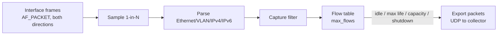

# NetFlow / IPFIX Export - Implementation Specification

Audience: the frontend developer (and collector operators). Status: **implemented**
in the native Linux backend, **Unreleased**, no release baseline. This document
describes the code as it behaves today; `FRONTEND_SPEC.md` section 6.9 stays the
canonical UI contract and links here for detail. Where the two differ, report it
rather than guessing.

The configuration key is still called `softflowd` for historical reasons, but there
is **no softflowd program**. Capture and export run in-process in Rust
(`netcontrol-services`, `flow.rs`). Nothing external is started, controlled or
parsed.

## 1. What it does

One **exporter instance** captures packets on one interface, groups them into
unidirectional flows, and sends expired flows as NetFlow v1, v5, v9 or IPFIX records
over UDP to one collector. Up to 16 instances can be configured (including disabled
ones). Each enabled instance is one worker thread with its own packet socket.



## 2. Configuration

Path: `config.softflowd[]` inside the complete configuration of
`POST /api/v1/transactions`. Changes need `transactions.write` **and**
`softflowd.write`. Reads of the configured and observed value need `state.read`.

| Field | Type | Required | Rules |
| --- | --- | --- | --- |
| `name` | string | yes | `^[A-Za-z0-9_-]{1,32}$`, unique among instances |
| `enabled` | boolean | yes | Disabled entries are saved and fully validated but run nothing |
| `interface` | string | yes | Valid interface name; a managed interface or an operator-adopted parent. The server preflight is authoritative |
| `collector` | string | yes | Canonical numeric `IP:port`, nonzero port, IPv6 bracketed (`[2001:db8::1]:4739`); unicast or loopback; no DNS name, zone or mapped IPv6 |
| `export_version` | integer | yes | `1`, `5`, `9` or `10`; **10 is IPFIX** |
| `sampling_rate` | integer | yes | 1..1,000,000. `1` = every packet. Version 5 is limited to 16,383 |
| `max_flows` | integer | yes | 1..1,000,000 concurrent flows held in memory |
| `snaplen` | integer | yes | 64..65,535 bytes captured per packet |
| `promiscuous` | boolean | yes | Adds packet-socket promiscuous membership on the interface |
| `capture_filter` | string | no | Exactly `""`, `ip`, `ip6`, `tcp`, `udp`, `icmp` or `icmp6`; anything else is rejected (this is not BPF). Omitted from responses when empty |
| `timeouts` | object | no | Keys `general`, `tcp`, `tcp.rst`, `tcp.fin`, `udp`, `icmp`, `maxlife`, `expint`; integer seconds 0..604,800; `general` must be >= 1. Defaults to `{}` |
| `metadata` | object | no | `display_name` (128) and `description` (2048); omitted when empty |

There are **no server defaults** for the required numeric fields. A form may offer a
preset, but it must be visibly a frontend preset and must never be applied silently
to an existing record.

Other rules:

- `ipv6_enabled: false` rejects an IPv6 collector and the `ip6`/`icmp6` filters.
- Missing required fields or wrong types return `400`; semantic failures
  (limits, names, collector address, interface) return `422`.
- Keys the server does not know inside `config` are **dropped and reported** in the
  submit response's `ignored_fields`, so a misspelled optional key is a silent
  no-op. Show that list. A misspelled *required* key still fails as a missing field.
- Authorization follows the normal transaction flow: submit applies and the change
  stays pending until `POST /api/v1/transactions/{id}/confirm`; an unconfirmed or
  failed change is rolled back.

```json
{
  "name": "office",
  "enabled": true,
  "interface": "lan0",
  "collector": "198.51.100.50:4739",
  "export_version": 10,
  "sampling_rate": 100,
  "max_flows": 65536,
  "snaplen": 256,
  "promiscuous": false,
  "capture_filter": "",
  "timeouts": {"general": 60, "tcp": 300, "tcp.fin": 10, "tcp.rst": 5,
               "udp": 30, "icmp": 30, "maxlife": 3600, "expint": 10},
  "metadata": {"display_name": "Office traffic export", "description": "Sampled IPFIX"}
}
```

A complete request is in `examples/vlan-softflowd.json`.

```ts
interface SoftflowdConfig {
  name: string;
  enabled: boolean;
  interface: string;
  collector: string;
  export_version: 1 | 5 | 9 | 10;
  sampling_rate: number;
  max_flows: number;
  snaplen: number;
  promiscuous: boolean;
  capture_filter?: "" | "ip" | "ip6" | "tcp" | "udp" | "icmp" | "icmp6";
  timeouts: Partial<Record<"general" | "tcp" | "tcp.rst" | "tcp.fin" |
                           "udp" | "icmp" | "maxlife" | "expint", number>>;
  metadata?: { display_name: string; description: string };
}
```

## 3. Capture and flow semantics

- **Capture point.** One packet socket bound to the interface, receiving frames in
  both directions (ingress and egress). The interface identity is not written into
  the records (see section 7), so use one instance per interface and distinguish
  them by collector port. Exporting the same traffic from two interfaces counts it
  twice.
- **Layers.** Ethernet with up to two VLAN tags (802.1Q/802.1ad), IPv4, IPv6
  (extension headers walked, at most 8), TCP, UDP, ICMP, ICMPv6. Other protocols are
  recorded with zero ports.
- **Excluded packets.** IPv4 fragments, IPv6 fragment headers, IPv6 jumbograms,
  non-IP frames and, for versions 1 and 5, all IPv6. They are counted, not
  guessed (section 5).
- **Sampling.** Deterministic: every Nth received packet is examined, counted before
  parsing and filtering. Reported counters describe the sampled packets; the server
  does **not** multiply them. A collector must scale by the sampling interval.
- **Flow key.** Source IP, destination IP, source port, destination port, protocol
  and IP type of service (TOS / traffic class). Flows are **unidirectional**: each
  direction is its own flow. For ICMP and ICMPv6, the destination-port field carries
  `type << 8 | code`.
- **Bytes.** The IP total length of each sampled packet (layer 3, excluding the
  Ethernet header). Packets counts each sampled packet once.
- **TCP flags.** OR of all flags seen in the flow.
- **Collector traffic is excluded.** UDP packets destined to the configured
  collector IP and port are skipped to avoid export feedback loops.
- **Capture filter.** Applied after parsing: `ip` IPv4 only, `ip6` IPv6 only,
  `tcp`, `udp`, `icmp` (IPv4 ICMP only), `icmp6` (ICMPv6 only).

### Expiry and export

A flow is exported when any of these happens, then removed from the table:

| Trigger | Rule |
| --- | --- |
| Idle | No packet for the idle timeout of its class: `tcp.rst` if a RST was seen, else `tcp.fin` if a FIN was seen, else `tcp`; `udp`; `icmp` (ICMP and ICMPv6); anything else uses `general`. Any class not set falls back to `general`, and `general` defaults to 60 s |
| Maximum life | Older than `maxlife` seconds (default 3600) since the first packet |
| Capacity | The table is full and a new flow arrives: the least recently updated flow is exported early |
| Counter overflow | Versions 1 and 5 only: a flow nearing the 32-bit packet/byte limit is exported early |
| Shutdown | All remaining flows are flushed when the worker stops |

A timeout of `0` disables that timeout (except `general`, which must be >= 1).
`expint` is how often the table is scanned, default 1 second; `expint: 0` scans on
every capture poll. Status counters refresh on the same scan. Idle flows can
therefore be exported up to one scan interval late.

Export packets hold at most 24 records (v1) or 30 (v5, v9, IPFIX). A batch must be
delivered within 2 seconds and each UDP write has a 250 ms timeout; failure puts the
worker in `error` (section 5).

Capacity and counter-overflow expirations are coalesced at the end of the current
receive batch (up to 64 frames), with at most 64 pending records, then split into
the same wire-format record limits. They do not require one UDP datagram per
expired flow. Flows are tracked in a randomly seeded hash table with a separate
least-recently-updated ordered index. Timeout classes are cached at worker
preparation; packet updates and expiry scans each use one monotonic timestamp.
Flow limits, timeout precedence, sampling, counters and protocol schemas are
unchanged; record ordering is not a collector contract.

## 4. Wire formats

| | v1 | v5 | v9 | IPFIX (10) |
| --- | --- | --- | --- | --- |
| Header | 16 bytes | 24 bytes | 20 bytes | 16 bytes |
| Address families | IPv4 | IPv4 | IPv4 + IPv6 | IPv4 + IPv6 |
| Record | 48-byte fixed | 48-byte fixed | template | template |
| Sequence | none | records exported | **packets** exported | **data records** exported |
| Counters | 32-bit | 32-bit | 64-bit | 64-bit |
| Timestamps | uptime ms | uptime ms | uptime ms | **absolute epoch ms** |
| Sampling information | **none** | header field | per-record fields | per-record fields |

- **v1/v5:** integers are network byte order; TCP flags at record offset 40 (v1) or
  37 (v5). Interface indexes, next hop and masks are zero. v5 puts mode `01`
  (packet interval) and the interval in the header's sampling field when the rate is
  above 1.
- **v9 and IPFIX** use template IDs **256 (IPv4)** and **257 (IPv6)**, **resent in
  every export packet**. Fields per record, in order: source address (IE 8 or 27),
  destination address (12 or 28), source port (7), destination port (11), protocol
  (4), type of service (5), TCP control bits (6, one byte), packets (2, 8 bytes),
  octets (1, 8 bytes), start and end time (v9: first/last switched 22/21,
  4 bytes; IPFIX: flowStartMilliseconds/flowEndMilliseconds 152/153, 8 bytes),
  sampling interval (34, 4 bytes) and sampling algorithm (35, value `1` =
  deterministic).
- **Observation domain / source ID (v9, IPFIX)** is random and chosen each time the
  worker starts, so it changes after a restart or service reconcile. Do not use it
  as a stable exporter identity.
- **Version 1 carries no sampling metadata.** Runtime reports
  `sampling_metadata: false` for it; never present v1 totals as unsampled or scaled.
- Transport is UDP only, with no acknowledgement, retransmission or delivery
  confirmation.

## 5. Runtime and status API

All `GET` requests need `state.read`. Base path `/api/v1`.

| Path | Result |
| --- | --- |
| `GET /services/softflowd` | Observed `SoftflowdConfig[]` |
| `GET /services/softflowd/status` | `{ "instances": SoftflowdStatus[], "error": string }` |
| `GET /runtime` | `RuntimeState`; its `softflowd` array is the same rows |
| `POST /services/softflowd/reconcile` | Bodyless; repairs **all** managed services; returns `RuntimeState` |

Reconcile needs `state.read`, `softflowd.write`, and the write permission of every
other enabled managed service (it restarts them collectively, may lose flow
caches, replays no networking and creates no revision). Block it while a transaction
is applying or rolling back.

One row per **configured** instance, enabled or not:

```ts
interface SoftflowdStatus {
  name: string;
  state: string;               // see below; unknown future values must be shown raw
  scope?: "managed";
  export_version?: 1 | 5 | 9 | 10;
  address_family?: "ipv4" | "dual";   // ipv4 when IPv6 is off or version is 1/5
  fragments?: "excluded";
  capture_filter?: string;
  sampling_rate?: number;
  sampling_metadata?: boolean;        // false only for version 1
  started_at?: string;                // RFC 3339, when the worker became running
  error?: string;
  dropped_packets?: string;           // exact decimal string
  statistics_complete?: boolean;
  active_flows?: number;              // flows currently in the table
  exported_flows?: number;            // cumulative since worker start
  excluded_packets?: number;          // sampled packets excluded (see section 3)
  filtered_packets?: number;          // sampled packets rejected by the filter
  malformed_packets?: number;         // sampled packets that failed parsing
}
```

Only a row whose worker exists (running, or failed with `error`) carries the static
fields; an enabled instance with no worker is just `{name, state: "stopped"}` and a
disabled one is `{name, state: "disabled"}`. The counters are JSON numbers (decimal
strings only for `dropped_packets`); treat them as bounded display values, not for
exact arithmetic past 2^53. All counters and `started_at` restart when the worker
restarts.

| `state` | Meaning |
| --- | --- |
| `running` | Worker is up. Local responsiveness only; collector delivery is **not** verified |
| `disabled` | Configured `enabled: false` |
| `stopped` | Enabled but no worker is running |
| `error` | Worker failed; `error` holds the text |
| `simulated` | Simulator backend; nothing is captured and no counters exist |
| anything else | Unknown future value: show it raw |

Missing runtime data means **Unknown**, not Disabled. A top-level `error` stays
visible even if rows look healthy. `dropped_packets` and `statistics_complete` are set
when the worker starts; `active_flows`, `exported_flows` and the packet counters
appear after the first table scan, so a freshly started worker can show `running`
without them.

### Packet drops

Capture uses nonblocking `recvmmsg` batches of up to 64 frames and processes at
most 256 frames before checking maintenance and shutdown. The worker polls for
readability with a 10 ms maximum wait instead of sleeping between batches;
already-queued traffic wakes it immediately. Userspace packet storage is bounded
at 64 times `snaplen` bytes per exporter.

Each exporter requests a 4 MiB socket receive buffer. Linux caps the request at
`net.core.rmem_max` and doubles the accepted value for socket memory accounting.
On hosts with a lower limit, operators can review that sysctl and raise it to at
least 4,194,304 bytes before restarting exporters if the memory budget permits.
The daemon does not modify host sysctls. Buffering absorbs bursts, not sustained
overload: capture and export still share a thread, so CPU contention, flow scans
and slow UDP writes can still produce drops. Increasing application sampling
does not reduce the packets initially queued by the kernel.

`dropped_packets` is the cumulative number of packets the kernel dropped from the
capture socket before the application saw them (before sampling and filtering). It
starts at `"0"` with `statistics_complete: true`. Any observed drop makes
`statistics_complete` **false until the worker restarts**, even if later polls are
loss-free. Drops do not stop export. This is not a count of lost flow records.

Show an inline warning naming the instance and the exact `dropped_packets` string
when `statistics_complete === false`, explaining that flow totals may undercount
traffic. Never convert it through JavaScript `Number`. Absent fields mean unknown,
not zero or complete. Never label a running worker loss-free or delivery-verified.
Do not retry or reconcile automatically because of a warning.

### Home Assistant MQTT stream

When MQTT streaming is enabled and at least one exporter is configured, each sample
also publishes, per instance, `state`, `statistics_complete`, `dropped_packets`
(exact decimal string), `active_flows`, `exported_flows`, `excluded_packets`,
`filtered_packets` and `malformed_packets`, read from the same status rows. Values
without a running worker are unknown (not zero). See
[FRONTEND_SPEC.md](../FRONTEND_SPEC.md#614-home-assistant-mqtt-streaming).

## 6. Prerequisites and failure behavior

- **Native Linux backend only.** The simulator validates and echoes configuration but
  never captures. Other platforms cannot enable exporters.
- **Privilege.** The daemon needs raw packet capture (root/CAP_NET_RAW).
- **Host-service opt-in.** Outside an isolated lab namespace, any enabled exporter
  requires the daemon's host-services opt-in (`NETCONTROL_ALLOW_HOST_SERVICES=true`,
  set by the current install and upgrade scripts). Without it, enabling an exporter
  fails the transaction.
- **Collector reachability is the operator's job.** The collector needs a route from
  the appliance, and any firewall in front of it must allow the UDP port. The
  appliance does not check that anything is listening.
- **Startup failure** (interface missing, bind or socket error) makes the
  transaction fail and roll back. A later capture or export error moves the worker to
  `error`, can fail verification and block confirmation, and does not retry on its
  own; use the reconcile action after fixing the cause.
- A transaction whose configuration, **as the services layer sees it**, is unchanged
  leaves workers running. That view is the IPv6 policy, NTP, syslog, vnStat, each
  interface's name, kind, up state, addresses and DHCP relay, all flow exporters, all
  gateway monitors and the routes. A change to **any** of these (including an unrelated
  address or route edit) stops and restarts **all** native service workers, not only
  the exporter you edited. Each stopped exporter flushes its remaining flows, then
  starts with an empty table, new counters, a new `started_at` and (v9/IPFIX) a new
  observation domain. Edits outside that view (for example firewall rules or MTU)
  leave workers running. If the restart fails, the previous services configuration is
  restored and the error is reported.

## 7. Not provided

- Interface indexes (input/output), next hop, AS numbers and masks: always zero.
- Flow direction other than the unidirectional 5-tuple plus TOS; no bidirectional
  merge.
- Arbitrary BPF expressions, per-flow filtering by address or port, and VLAN or MAC
  fields.
- Delivery acknowledgement, retransmission, TCP/SCTP export, or more than one
  collector per instance.
- Persistent counters or flow caches across restarts; historical or aggregated flow
  data; a flow-query API. The appliance exports flows, it does not store them.
- Fragments and jumbograms (counted as excluded).

## 8. UI guidance

- Table: name, desired vs observed enabled, interface, collector, version label
  (`10` shown as IPFIX), runtime state, started time, error, staged state, and the
  drop warning when present.
- Editor: all fields in section 2, a version selector that disables sampling above
  16,383 for v5, an interface list of managed draft interfaces plus available adopted
  parents (mark adopted parents protected), and optional named timeout rows (absence
  means worker default, not zero).
- Validate locally as section 2 states, but let the server be authoritative; show
  its `error` text verbatim and never parse it for meaning.
- Explain that `sampling_rate` thins the data and that totals must be scaled by the
  collector; explain that v1 cannot convey sampling.
- Show the `ignored_fields` list after every submit.

## 9. Acceptance checks

1. Create an enabled instance, confirm it, and see `state: running`, `started_at`,
   and `active_flows` rising under traffic on that interface.
2. A collector on the configured port receives packets of the chosen version; for
   v9/IPFIX it receives templates 256/257 in every packet.
3. Set `sampling_rate` above 16,383 with version 5: rejected with `422`.
4. Point at an interface that does not exist: the transaction fails and rolls back.
5. Disable the instance: its row shows `disabled` and the worker stops (remaining
   flows are exported).
6. Under heavy load, `dropped_packets` and `statistics_complete: false` render the
   warning and stay false until reconcile or restart.
7. Simulator: `simulated`, no counters, no fabricated totals.
8. On a disposable Linux namespace, sustain more than 25,600 capture frames/s
   (the old receive-loop ceiling), verify exact exported packet/byte counts with
   sampling intervals 1 and 4, no capture drops, and shutdown within one second
   while traffic is still arriving. This is a regression fixture, not an
   appliance throughput guarantee.
9. Queue a bounded burst of 128 distinct UDP flows into an exporter with
   `max_flows: 8`. Verify every flow is exported exactly once with both loopback
   capture copies, exact bytes, contiguous v5 record sequence numbers, zero
   capture drops, and fewer than 64 export datagrams. This exercises capacity
   eviction, bounded early-export batching and the final idle flush together.

Backend validation for this feature (protocol encoders, IPv6 parsing, filters,
timeouts, sampling, drops, real capture and export in a disposable namespace) is in
`crates/netcontrol-services/src/flow.rs` and `integration.rs`. Browser behavior and
physical appliance capture are not verified here.

## References

- [Canonical UI contract](../FRONTEND_SPEC.md#69-softflowd)
- [Service implementation notes](../crates/netcontrol-services/README.md)
- [Collector example request](../examples/vlan-softflowd.json)
- [Worker implementation](../crates/netcontrol-services/src/flow.rs)
